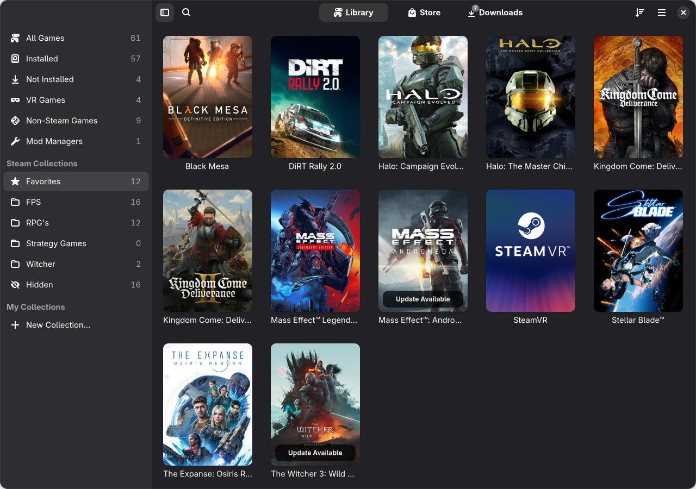
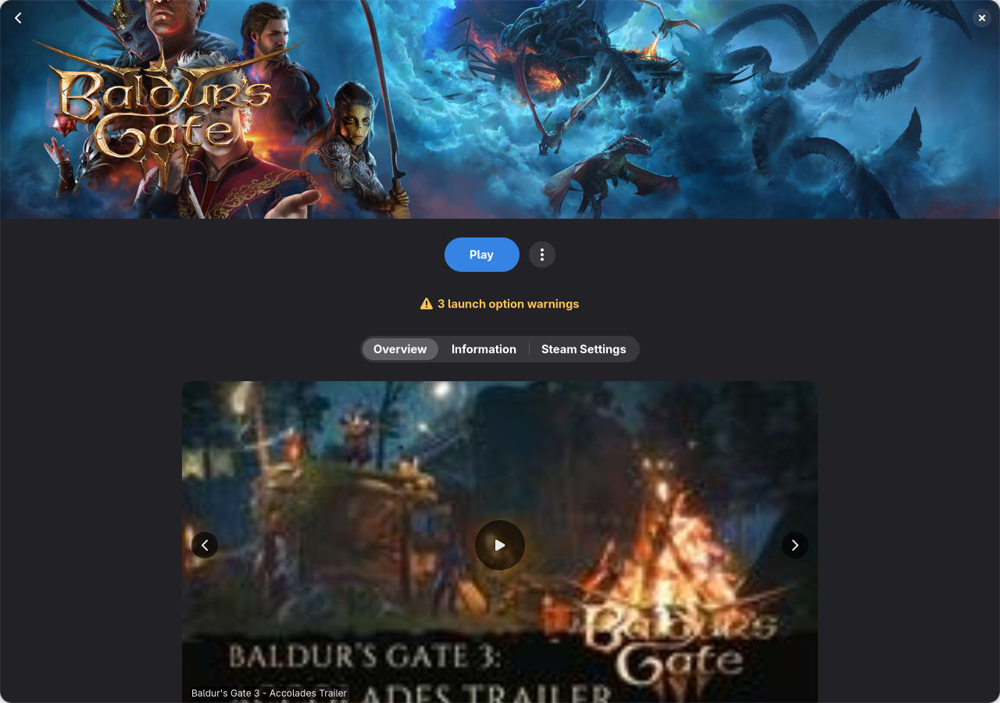
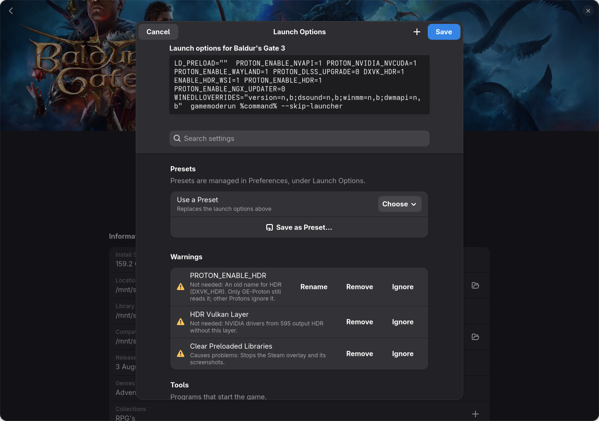
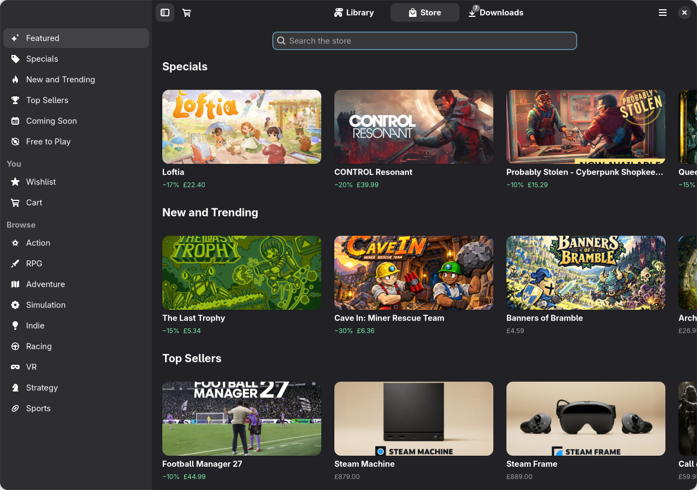
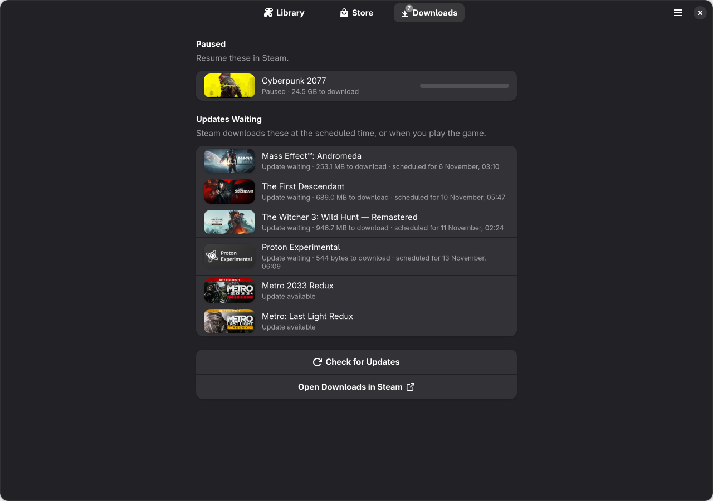

<p align="center">
  
</p>

# Superlion

Superlion is a native Linux app for your Steam library, built with GTK 4 and libadwaita. It shows the games you've installed and the ones you own, and lets you browse the store, sort out launch options, Proton builds and artwork, and stream games through Sunshine, all without opening Steam's own window. If you'd rather your games looked and behaved like the rest of your desktop, it's for you.



## What it does

- **Your whole library in one place**: installed games, games you own but haven't installed, and non-Steam games.
- **Find things quickly**: filter by Steam's collections or your own, search by name, initials or app ID, and sort or group by size, last played, release date or genre.
- **A page for every game**: trailers, screenshots, news and install details. Play turns into Stop while it's running.
- **Launch options without the guesswork**: switch over 100 common settings on and off, with warnings for ones that clash or do nothing.
- **Proton builds**: install and update GE-Proton and Proton-CachyOS from Preferences.
- **The Steam store, natively**: browse with local prices, and manage your wishlist and cart.
- **Downloads**: see what Steam's downloading, with progress on each game's cover.
- **Non-Steam games**: add them from Files and match them to a store game for its artwork and news. Artwork can also come from [SteamGridDB](https://www.steamgriddb.com).
- **Mod managers**: link one to a game and launch it from the game's page.
- **Streaming**: send games to Moonlight through Sunshine.

## Screenshots

| | |
|---|---|
|  |  |
|  |  |

## Streaming with Sunshine

**Add to Sunshine** in a game's menu adds it to [Sunshine](https://github.com/LizardByte/Sunshine) so you can start it from Moonlight. For HDR, you'll need Sunshine from [LizardByte's COPR](https://copr.fedorainfracloud.org/coprs/lizardbyte/stable/) rather than the Flatpak or AppImage.

While you're streaming, Superlion switches the chosen display to match the client's resolution, refresh rate and dynamic range, then puts everything back afterwards. You can stream from your main monitor, with the others switched off, or from a dummy plug, which leaves your own monitors alone. A dummy plug can be made to act as a 4K, 1440p or 1080p HDR display. That installs an EDID file in `/usr/lib/firmware/edid/` and adds the `drm.edid_firmware` boot option, so you'll be asked for your password. Superlion can also quit EasyEffects for surround sound and hide the dock and notifications during a stream.

## Installing

On Fedora, install it from [COPR](https://copr.fedorainfracloud.org/coprs/solartw/superlion/):

```bash
sudo dnf copr enable solartw/superlion
sudo dnf install superlion
```

Store trailers need an H.264 decoder, such as `gstreamer1-plugin-libav` or `gstreamer1-plugin-openh264`.

To build the RPM yourself, run `packaging/build-rpm.sh` and you'll find it in `dist/`.

## Setup

The first time you open Superlion, a setup wizard finds your Steam installation, account and library folders. It'll also offer to connect your Steam account with your own Steam Web API key, which Valve gives every account for free, and SteamGridDB with a free API key. Both keys are kept in your system keyring. If your profile's game details are private, your owned games are read through the Steam store sign-in instead. You can change anything the wizard sets later in Preferences.

## How changes reach Steam

Steam keeps some of its files in memory and overwrites them when it quits, so Superlion only writes to them while Steam's closed. If Steam's running, your changes wait until it quits, and a banner offers to restart Steam so they're applied straight away. Every file is backed up to `<file>.superlion-bak-<date>-<time>` before it's written.

| Change | Steam file |
|---|---|
| Launch options | `userdata/<account>/config/localconfig.vdf` (non-Steam games: `shortcuts.vdf`) |
| Compatibility tool | `config/config.vdf` |
| Non-Steam game names | `userdata/<account>/config/shortcuts.vdf` |
| Collections, Favourites and Hidden | `userdata/<account>/config/cloudstorage/cloud-storage-namespace-1.json` |

Custom artwork goes straight into `userdata/<account>/config/grid`, which Steam doesn't hold in memory. Games added to Sunshine go into `~/.config/sunshine/apps.json`, and Sunshine's restarted to pick them up, unless a game's streaming.

## Privacy

Superlion only talks to Valve and SteamGridDB. API keys stay in your system keyring, and account data is cached in `~/.cache/superlion/`.

## Files

| Location | Contents |
|---|---|
| `~/.config/superlion/config.json` | Choices from setup and Preferences |
| `~/.config/superlion/collections.json` | Your own collections, and edits waiting to be synced to Steam |
| `~/.config/superlion/steam_matches.json` | Store matches you chose for non-Steam games |
| `~/.config/superlion/mod_managers.json` | Mod managers and the games linked to them |
| `~/.config/superlion/launch_presets.json` | Launch option presets |
| `~/.config/superlion/launch_settings.json` | Your custom settings for the launch options editor |
| `~/.local/share/superlion/` | Changes waiting for Steam to close, the store's cookies, and covers for Sunshine |
| `~/.cache/superlion/` | Owned-games list, Steam's app data, store data, downloaded artwork, automatic store matches and your account's country |

## The name

Superlion is named after the Fowler B6 Super Lion traction engine, and is dedicated to the memory of John Wharton (1953–2026).
